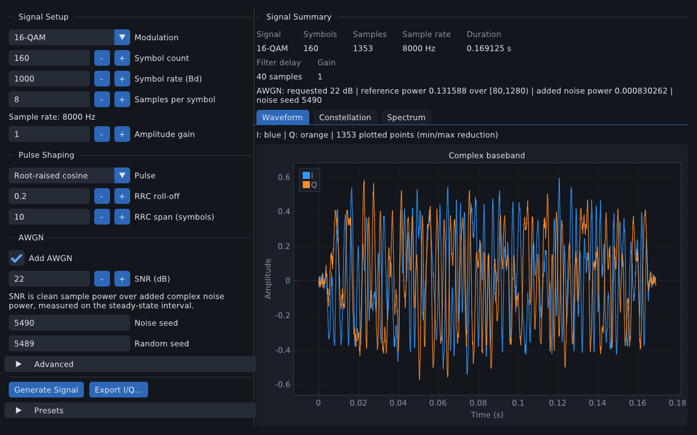
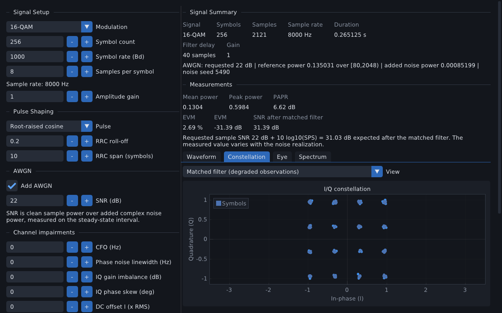
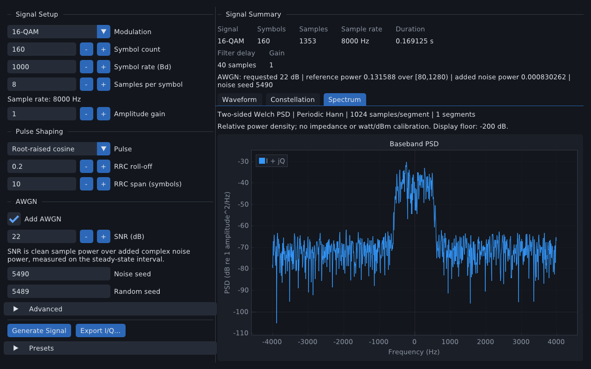
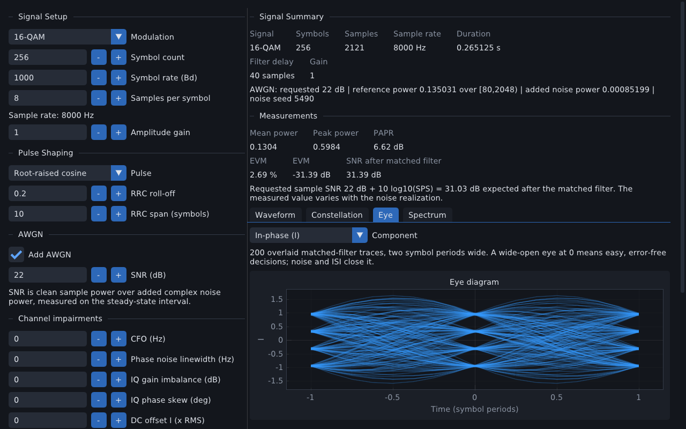
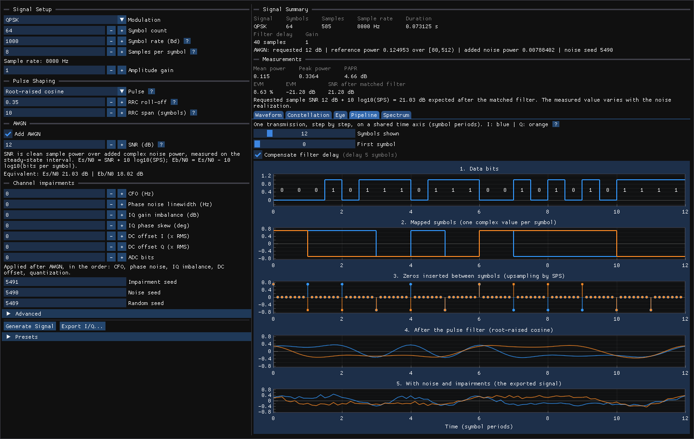

# Siggen

[](https://github.com/ronnymilleo/siggen/actions/workflows/ci.yml)

A C++23 signal generator with a Dear ImGui/ImPlot desktop application (the
default executable, `siggen`) and a separate command-line tool (`siggen-cli`).
Generate reproducible complex I/Q samples for BPSK, QPSK, OQPSK, pi/4-DQPSK,
DBPSK, DQPSK, 8-PSK, 8-DPSK, 4-ASK, OOK, 4-PAM, 16/32/64/256-QAM, 2-FSK, 4-FSK, MSK,
and complex white Gaussian noise (WGN), with optional AWGN and simple channel
impairments on linear signals; inspect waveforms, constellations, eye diagrams,
a two-sided spectrum and measurements (PAPR, EVM, measured SNR); work through
guided lesson presets; save presets; export single signals; and
export SigMF recordings, measure recordings with `siggen-cli analyze`, script it all from Python/NumPy, and generate swept fixed-length frame datasets (`siggen-cli batch`) for classifier
training. This application generates complex baseband, not an RF carrier.

<div align="center">
  
  <p align="center"><em>Waveform - 16-QAM, RRC pulse shaping, 22 dB SNR</em></p>

  
  <p align="center"><em>Constellation - matched-filter observations</em></p>

  
  <p align="center"><em>Spectrum - two-sided Welch PSD</em></p>

  
  <p align="center"><em>Eye - overlaid symbol-period traces</em></p>

  
  <p align="center"><em>Pipeline - bits to transmitted samples, step by step</em></p>
</div>

## Build and test

Requirements: CMake 3.28+, a C++23 compiler and standard library (including
`std::ios::noreplace`), and Ninja for the commands below. Vendor dependencies are
pinned Git submodules; no dependency download occurs during CMake configuration.

```sh
git submodule update --init --recursive
cmake -S . -B build -G Ninja -DCMAKE_BUILD_TYPE=Debug -DSIGGEN_BUILD_TESTS=ON -DSIGGEN_BUILD_PYTHON=ON
cmake --build build
ctest --test-dir build --output-on-failure
./out/debug/bin/siggen
```

The default executable `siggen` opens the desktop application. Signal
generation, batch, analysis and BER live in the separate command-line tool
`siggen-cli` (for example `./out/debug/bin/siggen-cli --help`).

The build is shaped by cache options:

| Option | Default | Effect |
|---|---|---|
| `SIGGEN_BUILD_GUI` | `ON` | Build the `siggen` desktop application and its library |
| `SIGGEN_BUILD_CLI` | `ON` | Build the `siggen-cli` command-line tool and its library |
| `SIGGEN_BUILD_TESTS` | `OFF` | Build the GoogleTest executables |
| `SIGGEN_BUILD_PYTHON` | `OFF` | Build the `siggen_c` shared library used by the Python package |
| `SIGGEN_ENABLE_WARNINGS` | `ON` | Enable project compiler warnings |
| `SIGGEN_SANITIZER` | `none` | `none`, `address-undefined`, or `thread` (Linux with GCC or Clang) |

Common configurations:

```sh
# Release build of the GUI and the CLI
cmake -S . -B build-release -G Ninja -DCMAKE_BUILD_TYPE=Release

# Headless: CLI and tests only, no graphics libraries needed
cmake -S . -B build-headless -G Ninja -DCMAKE_BUILD_TYPE=Debug -DSIGGEN_BUILD_GUI=OFF -DSIGGEN_BUILD_TESTS=ON

# Address + undefined-behavior sanitizers on the headless tests
cmake -S . -B build-asan -G Ninja -DCMAKE_BUILD_TYPE=Debug -DSIGGEN_BUILD_GUI=OFF \
  -DSIGGEN_BUILD_TESTS=ON -DSIGGEN_SANITIZER=address-undefined

# Library only (no executables): needs just the stb and json submodules
cmake -S . -B build-lib -G Ninja -DSIGGEN_BUILD_GUI=OFF -DSIGGEN_BUILD_CLI=OFF
```

Tests print failures on run. GoogleTest is included
only when `SIGGEN_BUILD_TESTS=ON`; Threads is discovered only for the CLI, GUI, or tests.
The GUI requires OpenGL and the platform development libraries used by the pinned
GLFW. On Linux its default backend is X11, which also runs through XWayland.
GLFW examples, tests, documentation, and installation default off. GoogleMock and ImGui/ImPlot demo sources are excluded from default builds.

Executables are in `out/<build-type>/bin/` and libraries in `out/<build-type>/lib/`
of the source tree, while the CMake cache and objects stay in the build directory
(`build*` in `.gitignore`). `compile_commands.json` of the last build is copied to the
repository root for editors and `clang-tidy`. In-source builds are rejected. If clang-format is
available, building either executable first formats every project source
(the `format` target), so commit the formatted files. Identifier naming is checked
with `run-clang-tidy -p build '/(app-core|app-cli|app-gui|tests)/|/main\.cpp$'`; see `CLAUDE.md` for the
code conventions.

## Documentation

Everything else lives in [docs/](docs/):

- [Command line, logging and batch datasets](docs/command-line.md): `siggen-cli` options, presets on the command line, log levels and `siggen-cli batch`.
- [Using the GUI](docs/using-the-gui.md): controls, measurements, the eye diagram, spectral windows, the Pipeline tab, views and spectrum calibration, and exporting plot images as PNG or SVG.
- [Modulations, mapping and reproducibility](docs/modulations.md): every mapping (PSK, QAM, PAM, ASK, differential schemes, OQPSK, FSK/MSK), seeds and bit order.
- [Noise, SNR and channel impairments](docs/noise-and-impairments.md): AWGN, SNR vs Es/N0 vs Eb/N0, CFO, phase noise, IQ imbalance, DC offset and quantization.
- [Pulse gain, length and timing](docs/signal-timing.md): amplitude gain, filter length, delay and sample counts.
- [Presets and I/Q export](docs/presets-and-export.md): guided lessons, preset format, CSV, binary and SigMF export and metadata.
- [Bit error rate and the reference receiver](docs/ber-and-receiver.md): the ideal receiver, BER against Eb/N0 with theory, `siggen-cli ber`, the BER tab and the Python API.
- [Analysis, SigMF and Python](docs/analysis-and-python.md): `siggen-cli analyze`, reading recordings, the NumPy-based Python package and the notebooks.
- [Architecture and validation](docs/architecture.md): source layout, tests and sanitizer workflows.

## License

Siggen is distributed under the GNU General Public License, version 3. See
[`LICENSE`](LICENSE) for the complete license text.
